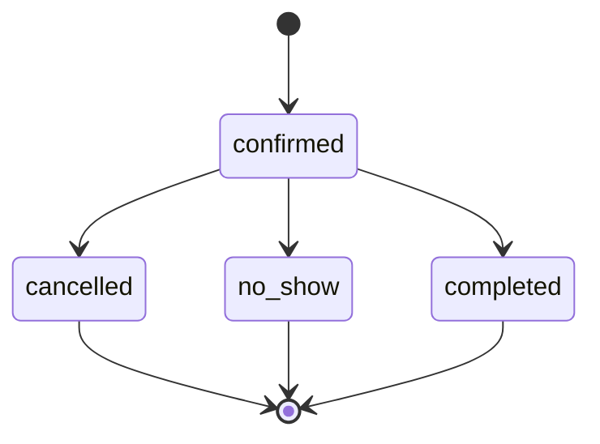
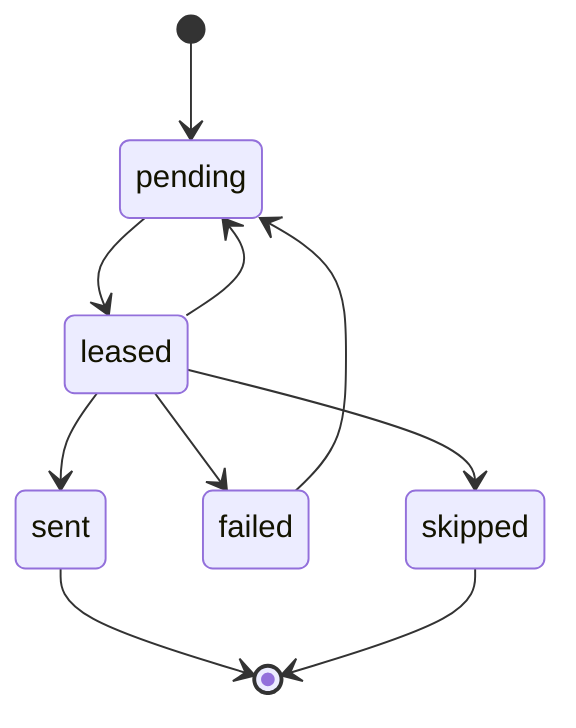
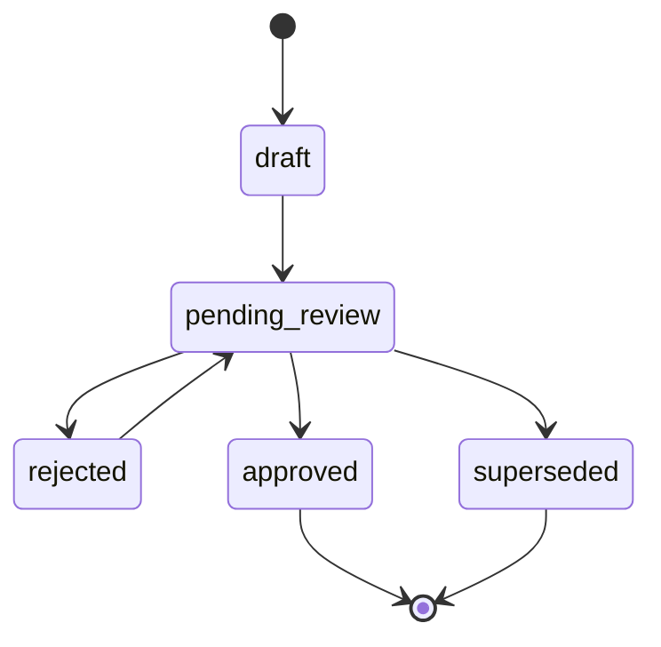
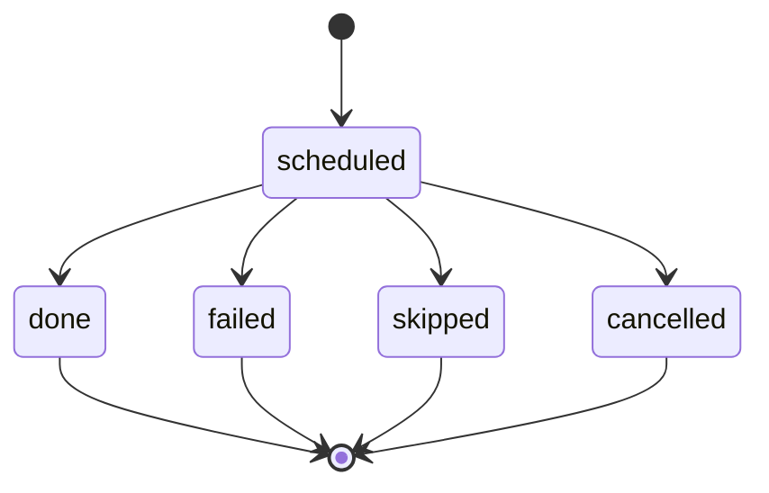
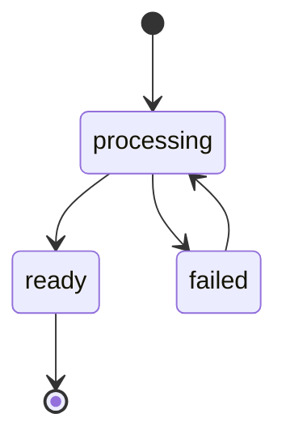
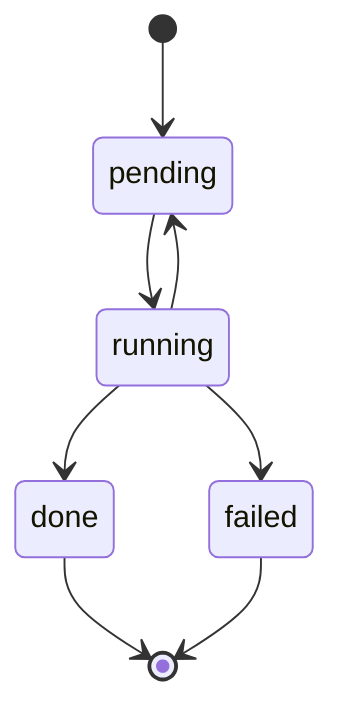
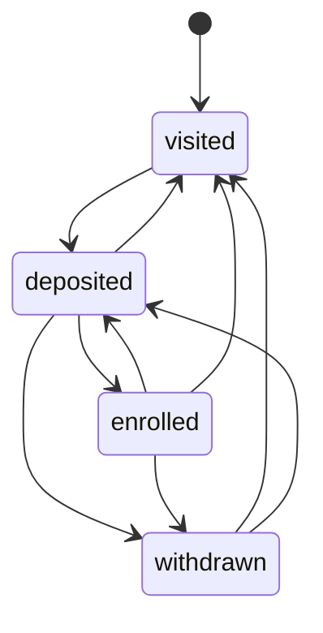
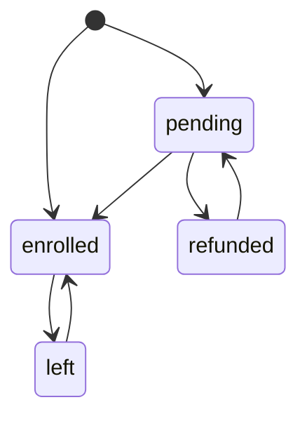
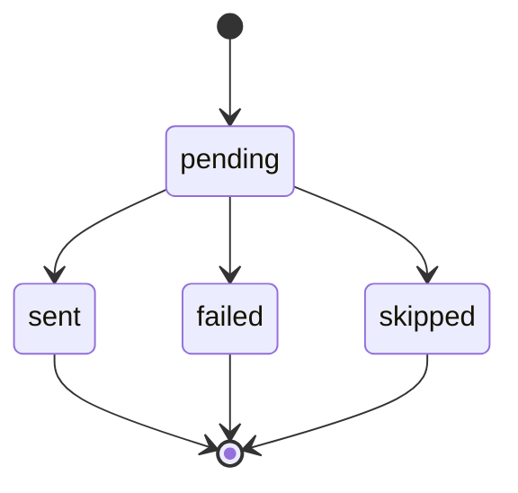
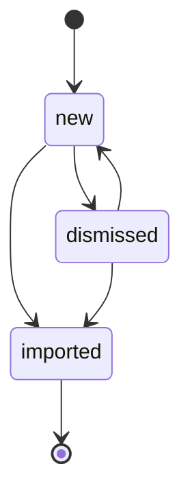

# 領域狀態機

> 由 backend/scripts/export_state_machines.py 產生，來源是 backend/app/state_machines.py。不要手改；改登記表後跑 npm run contract:generate。

怎麼用這份文件、前端流程的狀態、以及新增狀態時的規矩，見同目錄的 [README.md](README.md)。

## 目錄

有狀態欄位的：

- [預約參觀案件](#visit_request)：4 個狀態
- [通知 outbox](#outbox_message)：5 個狀態
- [內容版本的審核狀態](#content_revision)：5 個狀態
- [排程發布](#publish_job)：5 個狀態
- [素材](#media_asset)：3 個狀態
- [影片轉檔工作](#media_job)：4 個狀態
- [招生訪視的階段](#recruitment_stage)：4 個狀態
- [編班的幼生](#roster_student)：4 個狀態
- [廣告轉換回傳](#ad_conversion_job)：4 個狀態
- [粉專貼文收件匣](#facebook_page_post)：3 個狀態

由欄位推導的：

- [家長管理連結與 session](#parent_access)：3 個狀態
- [參觀場次](#visit_slot)：4 個狀態
- [後台登入 session](#admin_session)：3 個狀態
- [重設密碼連結](#password_reset_token)：4 個狀態
- [後台帳號](#user_account)：2 個狀態
- [素材的刪除](#media_deletion)：2 個狀態
- [沒發布的排程是否已處理](#publish_job_resolution)：2 個狀態
- [錯誤回報分組](#error_group)：2 個狀態

## 預約參觀案件（`visit_request`）

- 實體：`backend/app/booking/models.py` 的 `VisitRequest`，狀態欄位：`status`
- 狀態：`confirmed` 預約正常、`cancelled` 已取消、`no_show` 未到場、`completed` 已到場
- 可以寫這個狀態的檔案：`backend/app/booking/service.py`、`backend/app/booking/workflow_service.py`
- 終態（進去就不再變）：`cancelled`、`no_show`、`completed`

| 從 | 到 | 寫入的函式 | 條件 | 連帶做的事 |
|---|---|---|---|---|
| （建立） | `confirmed` | `backend/app/booking/service.py` 的 `submit_visit_request` | 官網送單；同一個交易排進場次，名額不足整筆不成立 | 發家長管理連結、通知園方、有留 Email 才寄確認信 |
| （建立） | `confirmed` | `backend/app/booking/service.py` 的 `create_manual_visit_request` | 後台補登（電話、LINE、親自到園） | — |
| `confirmed` | `cancelled` | `backend/app/booking/workflow_service.py` 的 `cancel` | 已取消再取消是冪等的（直接回傳、不寫歷程）；未到場、已到場不能取消 | 寫 cancelled_at、cancel_reason；撤銷家長連結；通知園方；有場次才寄取消信；名額釋出 |
| `confirmed` | `no_show` | `backend/app/booking/workflow_service.py` 的 `mark_no_show` | 場次開始後才能標；家長事先說不來走取消 | 撤銷家長連結；名額仍占用 |
| `confirmed` | `completed` | `backend/app/booking/workflow_service.py` 的 `mark_completed` | 場次開始後才能標；提早到（early）不等場次開始 | 撤銷家長連結；排廣告到場回傳；招生入學開啟時同一個交易建招生訪視；提早到且場次在之後的日子會清掉 slot_id 釋出名額 |

改期（reschedule）與改資料不換狀態，只有 confirmed 能做。每個轉移都先 lock_status（SELECT … FOR UPDATE）重讀狀態。列表的「接下來／時間已過／已到場／已取消」是 app/booking/status_groups.py 由狀態加場次時間推導的顯示分組，不是另一個狀態欄位。守衛不通過一律 409 INVALID_TRANSITION。

## 通知 outbox（`outbox_message`）

- 實體：`backend/app/booking/models.py` 的 `OutboxMessage`，狀態欄位：`status`
- 狀態：`pending` 待寄送、`leased` 寄送中、`sent` 已寄出、`failed` 寄送失敗、`skipped` 已略過
- 可以寫這個狀態的檔案：`backend/app/booking/outbox.py`、`backend/app/notifications/reminders.py`、`backend/app/workers/lease_service.py`
- 終態（進去就不再變）：`sent`、`skipped`

| 從 | 到 | 寫入的函式 | 條件 | 連帶做的事 |
|---|---|---|---|---|
| （建立） | `pending` | `backend/app/booking/outbox.py` 的 `enqueue_outbox` | 給園方的通知 | — |
| （建立） | `pending` | `backend/app/booking/outbox.py` 的 `enqueue_parent_email` | 給家長的信；沒 Email、沒綁 LINE、這校也沒開通知型訊息才不排 | — |
| （建立） | `pending` | `backend/app/booking/outbox.py` 的 `enqueue_day_closed_email` | 休假日通知，同一天同一案只排一次 | — |
| （建立） | `pending` | `backend/app/notifications/reminders.py` 的 `_enqueue` | 定期工作排的提醒 | — |
| `pending` | `leased` | `backend/app/workers/lease_service.py` 的 `claim_next` | next_attempt_at 已到；租約過期的 leased 也會被重新認領 | — |
| `leased` | `sent` | `backend/app/workers/lease_service.py` 的 `ack` | — | — |
| `leased` | `pending` | `backend/app/workers/lease_service.py` 的 `fail` | 未達重試上限：退避 10/30/60/300/900 秒 | — |
| `leased` | `failed` | `backend/app/workers/lease_service.py` 的 `fail` | 重試滿 MAX_ATTEMPTS 次 | — |
| `leased` | `skipped` | `backend/app/workers/lease_service.py` 的 `skip` | 寄送當下已不適用（改期、取消、已處理） | — |
| `failed` | `pending` | `backend/app/workers/lease_service.py` 的 `requeue` | 後台手動重新排入；呼叫端先確認是 failed | 重試次數歸零；已送達的管道記在 notification_deliveries，重送時略過 |

status 欄位沒有資料庫 CHECK，值域只靠 OutboxStatus。案件結案後排隊中的通知不會被取消，而是寄送時由 app/notifications/service.py 依案件狀態決定寄或略過。

## 內容版本的審核狀態（`content_revision`）

- 實體：`backend/app/content/models.py` 的 `ContentRevision`，狀態欄位：`review_status`
- 狀態：`draft` 草稿、`pending_review` 待審核、`approved` 已核准、`rejected` 已退回、`superseded` 已被新版取代
- 可以寫這個狀態的檔案：`backend/app/content/routes.py`、`backend/app/content/service.py`
- 終態（進去就不再變）：`approved`、`superseded`

| 從 | 到 | 寫入的函式 | 條件 | 連帶做的事 |
|---|---|---|---|---|
| （建立） | `draft` | `backend/app/content/service.py` 的 `create_revision` | — | — |
| `draft` | `pending_review` | `backend/app/content/routes.py` 的 `submit_for_review` | 只能送最新版 | — |
| `rejected` | `pending_review` | `backend/app/content/routes.py` 的 `submit_for_review` | 只能送最新版 | — |
| `pending_review` | `approved` | `backend/app/content/routes.py` 的 `review_submission` | — | 核准即發布 |
| `pending_review` | `rejected` | `backend/app/content/routes.py` 的 `review_submission` | 必附原因 | 這一版還在等的排程一起取消 |
| `pending_review` | `approved` | `backend/app/content/service.py` 的 `_mark_live` | 待審版被直接發布、排程到期或還原時順手核准 | 通知送審人 |
| `pending_review` | `superseded` | `backend/app/content/service.py` 的 `supersede_pending_reviews` | 存了更新的一版，或有任何一版上線 | — |

「已發布」不在這個欄位：看 ContentItem.current_published_revision_id 與 SiteState.current_release_id。草稿被直接發布後 review_status 仍是 draft。發布與排程只擋 rejected。

## 排程發布（`publish_job`）

- 實體：`backend/app/content/models.py` 的 `PublishJob`，狀態欄位：`status`
- 狀態：`scheduled` 等待發布、`done` 已發布、`failed` 沒有發布、`skipped` 已略過、`cancelled` 已取消
- 可以寫這個狀態的檔案：`backend/app/content/routes.py`、`backend/app/content/publish_jobs.py`
- 終態（進去就不再變）：`done`、`failed`、`skipped`、`cancelled`

| 從 | 到 | 寫入的函式 | 條件 | 連帶做的事 |
|---|---|---|---|---|
| （建立） | `scheduled` | `backend/app/content/routes.py` 的 `create_schedule` | 時間在未來、版本比線上新、不是已退回的版本、通過 check_publishable | — |
| `scheduled` | `cancelled` | `backend/app/content/routes.py` 的 `cancel_schedule` | — | — |
| `scheduled` | `cancelled` | `backend/app/content/routes.py` 的 `review_submission` | 這一版被退回 | — |
| `scheduled` | `done` | `backend/app/content/publish_jobs.py` 的 `_run_one` | — | — |
| `scheduled` | `skipped` | `backend/app/content/publish_jobs.py` 的 `_run_one` | 官網已是較新的版本 | — |
| `scheduled` | `failed` | `backend/app/content/publish_jobs.py` 的 `_run_one` | 到期時內容不能發布（例如素材沒轉好） | — |
| `scheduled` | `failed` | `backend/app/content/publish_jobs.py` 的 `_fail_unexpected` | 執行時出了預期外的錯 | — |

status 欄位沒有資料庫 CHECK。failed／skipped 之後還有「已處理」這一層，見 publish_job_resolution。

## 素材（`media_asset`）

- 實體：`backend/app/media/models.py` 的 `MediaAsset`，狀態欄位：`status`
- 狀態：`processing` 處理中、`ready` 可用、`failed` 失敗
- 可以寫這個狀態的檔案：`backend/app/media/service.py`、`backend/app/media/jobs.py`
- 終態（進去就不再變）：`ready`

| 從 | 到 | 寫入的函式 | 條件 | 連帶做的事 |
|---|---|---|---|---|
| （建立） | `processing` | `backend/app/media/service.py` 的 `create_media_asset` | — | — |
| `processing` | `ready` | `backend/app/media/service.py` 的 `_write_image_variants` | 圖片：縮圖寫完 | — |
| `processing` | `failed` | `backend/app/media/service.py` 的 `_write_image_variants` | 圖片：縮圖失敗 | — |
| `processing` | `ready` | `backend/app/media/jobs.py` 的 `_apply` | 影片：process 工作做完（backfill 不動素材狀態） | — |
| `processing` | `failed` | `backend/app/media/jobs.py` 的 `_mark_failed` | 影片：process 工作失敗且不再重試 | — |
| `failed` | `processing` | `backend/app/media/jobs.py` 的 `retry` | 只有影片、失敗、未刪除的可以重新處理 | — |

刪除是另一個維度（deleted_at，見 media_deletion）。內容發布前要求用到的素材都是 ready 且未刪除（app/content/publish_jobs.py check_publishable）。資料庫的原生 enum media_status 存的是大寫成員名（PROCESSING…），API 回的是小寫的值；直接下 SQL 查要用大寫。

## 影片轉檔工作（`media_job`）

- 實體：`backend/app/media/models.py` 的 `MediaJob`，狀態欄位：`status`
- 狀態：`pending` 排隊中、`running` 轉檔中、`done` 完成、`failed` 失敗
- 可以寫這個狀態的檔案：`backend/app/media/jobs.py`
- 終態（進去就不再變）：`done`、`failed`

| 從 | 到 | 寫入的函式 | 條件 | 連帶做的事 |
|---|---|---|---|---|
| （建立） | `pending` | `backend/app/media/jobs.py` 的 `enqueue` | 同一個素材最多一筆 pending／running（uq_media_jobs_active） | — |
| `pending` | `running` | `backend/app/media/jobs.py` 的 `claim_next` | 租約過期的 running 也會被重新認領 | — |
| `pending` | `running` | `backend/app/media/jobs.py` 的 `process_now` | 不經排程直接處理 | — |
| `running` | `done` | `backend/app/media/jobs.py` 的 `_apply` | — | — |
| `running` | `done` | `backend/app/media/jobs.py` 的 `_finish` | 素材已不需要這份工作時直接收掉 | — |
| `running` | `pending` | `backend/app/media/jobs.py` 的 `_record_failure` | 可重試的失敗 | — |
| `running` | `pending` | `backend/app/media/jobs.py` 的 `release` | worker 關機時放回佇列 | — |
| `running` | `failed` | `backend/app/media/jobs.py` 的 `_mark_failed` | — | — |

收尾一律比對 leased_by，租約被別人接走的 worker 不能回寫。

## 招生訪視的階段（`recruitment_stage`）

- 實體：`backend/app/admissions/models.py` 的 `RecruitmentVisit`，狀態欄位：不存欄位，由 `withdrawn_at`、`enrolled`、`has_deposit` 推導
- 狀態：`visited` 已訪視、`deposited` 已預繳、`enrolled` 已註冊、`withdrawn` 退預繳／退註冊
- 可以寫這個狀態的檔案：`backend/app/admissions/funnel.py`

| 從 | 到 | 寫入的函式 | 條件 | 連帶做的事 |
|---|---|---|---|---|
| （建立） | `visited` | `backend/app/admissions/records.py` 的 `create_visit` | — | — |
| （建立） | `visited` | `backend/app/admissions/booking_link.py` 的 `ensure_from_visit_request` | 預約標記已到場時自動建立 | — |
| `visited` | `deposited` | `backend/app/admissions/funnel.py` 的 `transition` | 需要 admissions.write | — |
| `deposited` | `visited` | `backend/app/admissions/funnel.py` 的 `transition` | 需要 admissions.write | — |
| `deposited` | `enrolled` | `backend/app/admissions/funnel.py` 的 `transition` | 需要 admissions.convert | — |
| `enrolled` | `deposited` | `backend/app/admissions/funnel.py` 的 `transition` | 需要 admissions.convert | — |
| `enrolled` | `visited` | `backend/app/admissions/funnel.py` 的 `transition` | 需要 admissions.convert | — |
| `deposited` | `withdrawn` | `backend/app/admissions/funnel.py` 的 `transition` | 需要 admissions.write | — |
| `enrolled` | `withdrawn` | `backend/app/admissions/funnel.py` 的 `transition` | 需要 admissions.convert | — |
| `withdrawn` | `visited` | `backend/app/admissions/funnel.py` 的 `transition` | 需要 admissions.write | — |
| `withdrawn` | `deposited` | `backend/app/admissions/funnel.py` 的 `transition` | 需要 admissions.write | — |

階段不存欄位：Python 用 funnel.derive_stage、SQL 用 funnel.stage_condition 推導，兩者規則相同。funnel.transition 是全模組唯一寫 enrolled、has_deposit、withdrawn_at 的地方，執行期就是讀 funnel._CAPABILITY。從已註冊退出後再取消退出一律要 admissions.convert（funnel.visit_transition_capability）。

## 編班的幼生（`roster_student`）

- 實體：`backend/app/admissions/roster/models.py` 的 `RosterStudent`，狀態欄位：`status`
- 狀態：`pending` 預繳未入園、`enrolled` 在籍、`left` 已離園、`refunded` 已退預繳
- 可以寫這個狀態的檔案：`backend/app/admissions/roster/service.py`、`backend/app/admissions/roster/sync.py`

| 從 | 到 | 寫入的函式 | 條件 | 連帶做的事 |
|---|---|---|---|---|
| （建立） | `pending` | `backend/app/admissions/roster/sync.py` 的 `on_stage_changed` | 招生看板轉成已預繳時自動建立 | — |
| （建立） | `pending` | `backend/app/admissions/roster/service.py` 的 `create_students` | 手動補登預繳生 | — |
| （建立） | `enrolled` | `backend/app/admissions/roster/service.py` 的 `create_students` | 手動補登在籍生 | — |
| `pending` | `enrolled` | `backend/app/admissions/roster/service.py` 的 `enter_student` | 要先排進班級 | — |
| `enrolled` | `left` | `backend/app/admissions/roster/service.py` 的 `leave_student` | 離園日不能早於入園日 | — |
| `pending` | `refunded` | `backend/app/admissions/roster/service.py` 的 `refund_student` | 退預繳日不能早於預繳日期 | — |
| `refunded` | `pending` | `backend/app/admissions/roster/service.py` 的 `restore_student` | 看板已為同一筆訪視重建預繳生時不能恢復 | — |
| `left` | `enrolled` | `backend/app/admissions/roster/service.py` 的 `restore_student` | 要選一個班級 | — |

和招生訪視的階段是兩台各自獨立的狀態機，只有看板→編班單向同步；兩邊分歧時由 roster/sync.py 的board_notices 在畫面提示，不自動修正。

## 廣告轉換回傳（`ad_conversion_job`）

- 實體：`backend/app/ad_conversions/models.py` 的 `AdConversionJob`，狀態欄位：`status`
- 狀態：`pending` 待回傳、`sent` 已回傳、`failed` 回傳失敗、`skipped` 已略過
- 可以寫這個狀態的檔案：`backend/app/ad_conversions/service.py`
- 終態（進去就不再變）：`sent`、`failed`、`skipped`

| 從 | 到 | 寫入的函式 | 條件 | 連帶做的事 |
|---|---|---|---|---|
| （建立） | `pending` | `backend/app/ad_conversions/service.py` 的 `enqueue` | 案件有點擊識別碼才排；同案同事件同平台只一筆 | — |
| `pending` | `sent` | `backend/app/ad_conversions/service.py` 的 `_process_one` | — | — |
| `pending` | `skipped` | `backend/app/ad_conversions/service.py` 的 `_process_one` | 已匿名、已排除、平台沒設定、過期或沒有識別碼 | — |
| `pending` | `failed` | `backend/app/ad_conversions/service.py` 的 `_process_one` | 平台拒收，或重試滿 MAX_ATTEMPTS 次 | — |

## 粉專貼文收件匣（`facebook_page_post`）

- 實體：`backend/app/facebook/models.py` 的 `FacebookPagePost`，狀態欄位：`status`
- 狀態：`new` 未處理、`imported` 已轉成消息、`dismissed` 已略過
- 可以寫這個狀態的檔案：`backend/app/facebook/routes.py`
- 終態（進去就不再變）：`imported`

| 從 | 到 | 寫入的函式 | 條件 | 連帶做的事 |
|---|---|---|---|---|
| （建立） | `new` | `backend/app/facebook/sync.py` 的 `_write_posts` | 同步只寫內文與媒體，不改已有貼文的狀態 | — |
| `new` | `dismissed` | `backend/app/facebook/routes.py` 的 `dismiss_facebook_post` | — | — |
| `dismissed` | `new` | `backend/app/facebook/routes.py` 的 `restore_facebook_post` | — | — |
| `new` | `imported` | `backend/app/facebook/routes.py` 的 `import_facebook_post` | 貼文要有照片 | — |
| `dismissed` | `imported` | `backend/app/facebook/routes.py` 的 `import_facebook_post` | 貼文要有照片 | — |

## 家長管理連結與 session（`parent_access`）

- 實體：`backend/app/booking/access_models.py` 的 `ParentAccessToken`，由 `expires_at`、`revoked_at` 推導，沒有狀態欄位

| 狀態 | 名稱 | 成立條件 |
|---|---|---|
| `active` | 有效 | revoked_at IS NULL 且 expires_at 還沒到 |
| `expired` | 已過期 | revoked_at IS NULL 且 expires_at 已到 |
| `revoked` | 已撤銷 | revoked_at 有值 |

- 判斷的地方：`backend/app/booking/access_service.py` 的 `exchange_token`、`backend/app/booking/access_service.py` 的 `parent_session_active`、`backend/app/booking/access_service.py` 的 `get_visit_request_for_session`、`backend/app/booking/access_service.py` 的 `active_access_token`
- 改動這些欄位的地方：`backend/app/booking/access_service.py` 的 `create_access_token`、`backend/app/booking/access_service.py` 的 `ensure_access_token`、`backend/app/booking/access_service.py` 的 `extend_token_expiry`、`backend/app/booking/access_service.py` 的 `revoke_access_for_visit_request`

ParentSession（同一個檔）用同一組欄位與規則，到期取 min(現在＋TTL, 連結到期)。案件結案（取消、未到場、已到場）與家長改 Email 都會撤銷；改期只延長到期。

## 參觀場次（`visit_slot`）

- 實體：`backend/app/booking/models.py` 的 `VisitSlot`，由 `closed`、`closed_source` 推導，沒有狀態欄位

| 狀態 | 名稱 | 成立條件 |
|---|---|---|
| `open` | 開放 | closed 為 false |
| `closed_manual` | 園方手動關閉 | closed 且 closed_source 是 manual（舊資料的 NULL 視同） |
| `closed_exception` | 休假日關閉 | closed 且 closed_source 是 exception |
| `closed_rule` | 不符合現行每週規則 | closed 且 closed_source 是 rule |

- 判斷的地方：`backend/app/booking/slot_service.py` 的 `is_publicly_bookable`、`backend/app/booking/slot_service.py` 的 `has_started`
- 改動這些欄位的地方：`backend/app/booking/slot_service.py` 的 `update_slot`、`backend/app/booking/schedule_service.py` 的 `sync_rule_slots`、`backend/app/booking/schedule_service.py` 的 `_reopen_rule_slots`、`backend/app/booking/schedule_service.py` 的 `add_exception`、`backend/app/booking/schedule_service.py` 的 `remove_exception`

「額滿」「已開始」「可預約」不是存的狀態：額滿是即時數已占用的案件，已開始看場次時間，可預約再加最短提前時間與最遠天數。取消休假日只重開 exception 關掉的場次。

## 後台登入 session（`admin_session`）

- 實體：`backend/app/auth/models.py` 的 `Session`，由 `expires_at`、`revoked_at` 推導，沒有狀態欄位

| 狀態 | 名稱 | 成立條件 |
|---|---|---|
| `usable` | 有效 | revoked_at IS NULL 且 expires_at 還沒到 |
| `expired` | 已過期 | revoked_at IS NULL 且 expires_at 已到 |
| `revoked` | 已撤銷 | revoked_at 有值 |

- 判斷的地方：`backend/app/auth/service.py` 的 `_session_usable`
- 改動這些欄位的地方：`backend/app/auth/service.py` 的 `create_session`、`backend/app/auth/service.py` 的 `refresh_session_expiry`、`backend/app/auth/service.py` 的 `revoke_session`、`backend/app/auth/service.py` 的 `revoke_user_sessions`

停用帳號、改密碼、用重設連結設新密碼都會撤銷該帳號的 session。

## 重設密碼連結（`password_reset_token`）

- 實體：`backend/app/auth/models.py` 的 `PasswordResetToken`，由 `used_at`、`revoked_at`、`expires_at` 推導，沒有狀態欄位

| 狀態 | 名稱 | 成立條件 |
|---|---|---|
| `usable` | 可用 | 三個條件都不成立，且帳號是啟用的 |
| `used` | 已使用 | used_at 有值 |
| `revoked` | 已作廢 | revoked_at 有值 |
| `expired` | 已過期 | expires_at 已到 |

- 判斷的地方：`backend/app/auth/password_reset.py` 的 `rejection`
- 改動這些欄位的地方：`backend/app/auth/password_reset.py` 的 `issue`、`backend/app/auth/password_reset.py` 的 `revoke_outstanding`、`backend/app/auth/password_reset.py` 的 `revoke_token`、`backend/app/auth/password_reset_routes.py` 的 `complete_password_reset`

判斷順序：帳號停用 → 已使用 → 已作廢 → 已過期。發新連結會作廢舊的。

## 後台帳號（`user_account`）

- 實體：`backend/app/auth/models.py` 的 `User`，由 `is_active` 推導，沒有狀態欄位

| 狀態 | 名稱 | 成立條件 |
|---|---|---|
| `active` | 啟用 | is_active 為 true |
| `inactive` | 停用 | is_active 為 false |

- 判斷的地方：`backend/app/auth/service.py` 的 `still_valid_for_login`
- 改動這些欄位的地方：`backend/app/auth/service.py` 的 `set_user_active`

最後一位啟用中的總管理者不能停用；停用會解除 LINE／Google 綁定、撤銷所有 session、作廢重設連結。

## 素材的刪除（`media_deletion`）

- 實體：`backend/app/media/models.py` 的 `MediaAsset`，由 `deleted_at` 推導，沒有狀態欄位

| 狀態 | 名稱 | 成立條件 |
|---|---|---|
| `kept` | 保留 | deleted_at IS NULL |
| `pending_purge` | 已刪除、等待清理 | deleted_at 有值 |

- 判斷的地方：`backend/app/media/service.py` 的 `purge_due`
- 改動這些欄位的地方：`backend/app/media/service.py` 的 `mark_deleted`、`backend/app/media/service.py` 的 `restore_deleted`、`backend/app/media/service.py` 的 `purge_due`

和 media_asset 的處理狀態互相獨立。被內容引用的素材不能刪；到期清理時發現又被引用會取消刪除。

## 沒發布的排程是否已處理（`publish_job_resolution`）

- 實體：`backend/app/content/models.py` 的 `PublishJob`，由 `status`、`acknowledged_at`、`finished_at` 推導，沒有狀態欄位

| 狀態 | 名稱 | 成立條件 |
|---|---|---|
| `unresolved` | 待處理 | status 是 failed／skipped，沒按過「知道了」，之後也沒有再發布 |
| `resolved` | 已處理 | acknowledged_at 有值，或內容在 finished_at 之後發布過 |

- 判斷的地方：`backend/app/content/publish_jobs.py` 的 `is_resolved`、`backend/app/content/publish_jobs.py` 的 `unresolved_condition`
- 改動這些欄位的地方：`backend/app/content/routes.py` 的 `acknowledge_schedule`

is_resolved（Python）與 unresolved_condition（SQL）是同一條規則的兩份寫法，改一邊要改另一邊。

## 錯誤回報分組（`error_group`）

- 實體：`backend/app/operations/models.py` 的 `ErrorGroup`，由 `resolved_at` 推導，沒有狀態欄位

| 狀態 | 名稱 | 成立條件 |
|---|---|---|
| `open` | 未處理 | resolved_at IS NULL |
| `resolved` | 已處理 | resolved_at 有值 |

- 判斷的地方：`backend/app/operations/error_reports.py` 的 `list_groups`
- 改動這些欄位的地方：`backend/app/operations/error_reports.py` 的 `upsert`、`backend/app/operations/error_reports.py` 的 `resolve`、`backend/app/operations/error_reports.py` 的 `resolve_all`

已處理的錯誤再發生時，upsert 會把它重新打開。
